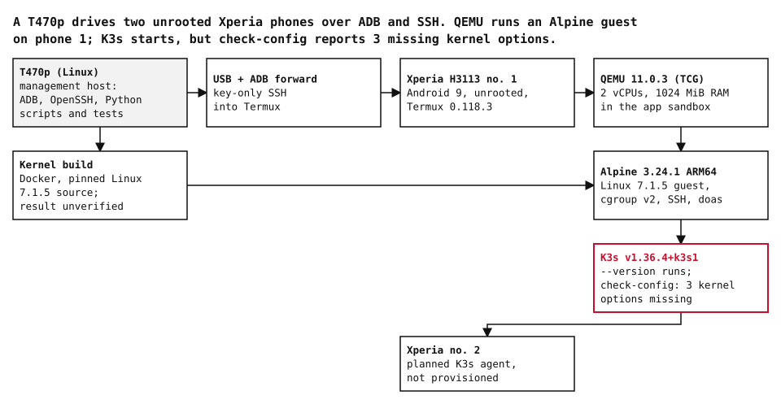

# agro-kubernetes

[Polski](README.pl.md)

A hobby Kubernetes lab exploring two Sony Xperia H3113 phones as real cluster nodes while retaining
locked, unrooted Android. QEMU supplies a separate ARM64 Linux kernel on each phone. The experiment
focuses on resource limits, guest networking and recovery after management disconnections.



## Current status

As of 2026-09-25, the first Xperia has a usable Linux guest. Kubernetes is blocked by missing
kernel features; the second phone has not been provisioned.

| Component | Observed state |
|---|---|
| Phone | H3113, Android 9 / 50.2.A.3.77; bootloader locked, Android unrooted |
| Management | Termux 0.118.3; dedicated key-only SSH over USB/ADB |
| Emulator | QEMU 11.0.3, multithreaded TCG, two vCPUs and 1024 MiB RAM |
| Guest | Official Alpine 3.24.1 tiny ARM64 cloud image; Linux 7.1.5 extracted from Podroid v1.2.9 without installing the APK |
| Guest access | Key-only SSH as `alpine`, with `doas` for administration |
| Guest services | Pure cgroup v2 and `mdevd` verified |
| Storage | Root filesystem expanded to 3.7 GiB; approximately 3.1 GiB available after K3s asset extraction |
| Recovery | QEMU and guest SSH survived an actual ADB transport loss and recovery |
| Screen-off continuity | Two samples 341 seconds apart retained the same guest boot ID while Android reported sleep |
| Kubernetes | K3s v1.36.4+k3s1 runs `--version`; `check-config` exits `4` with three missing kernel options |
| Replacement kernel | Linux 7.1.5 source build in progress; output, boot and runtime compatibility unverified |
| Test workload preparation | Official air-gap archive staged and verified in the guest; smoke manifest parsed offline, not applied |

No K3s service, Ready node, Pod or test workload has been verified. The current guest's 1024 MiB
RAM is below the documented K3s server minimum of 2 GB; the baseline also requires two CPU cores.
See [K3s requirements](https://docs.k3s.io/installation/requirements) and the
[verification record](docs/verification.md) for the exact kernel blocker and test boundaries.

## Architecture

The T470p manages Termux through an ADB-forwarded SSH connection. QEMU runs inside the Android app
sandbox and boots the guest directly from a verified kernel. The cloud image is a backing file
for a writable qcow2 overlay in app-private storage. No phone partition is used as a guest disk.

The target is one K3s server and one K3s agent on the two Xperias. The T470p remains a management
host. Kernel compatibility, sufficient server resources and a cross-phone guest network remain
unresolved. See [architecture](docs/architecture.md) for the current and planned topology.

## Prerequisites and entry points

The setup requires authorized USB debugging, Termux and a Linux management host with ADB, OpenSSH,
Bash, Python 3.11 or newer, `curl` and `bsdtar`. Keys, downloaded artifacts and VM state stay outside
Git. The scripts target the first phone; another device needs independently verified identities,
state paths and port mappings.

| Entry point | Purpose |
|---|---|
| [termux-inventory.sh](scripts/termux-inventory.sh), [termux-access.sh](scripts/termux-access.sh) | Inspect Termux and configure its dedicated loopback SSH listener |
| [termux-install-qemu.sh](scripts/termux-install-qemu.sh) | Install QEMU and check the available tools and firmware |
| [prepare-cloud.py](scripts/prepare-cloud.py) | Verify the pinned cloud image and create a public-key NoCloud seed |
| [prepare-kernel.py](scripts/prepare-kernel.py) | Verify and extract the standalone kernel and embedded configuration |
| [build-kernel.sh](scripts/build-kernel.sh) | Build a replacement ARM64 kernel from pinned source and the extracted baseline configuration |
| [termux-kernel-start.sh](scripts/termux-kernel-start.sh) | Boot the current cloud guest with the verified kernel |
| [xa2-ssh](scripts/xa2-ssh), [xa2-guest-ssh](scripts/xa2-guest-ssh) | Connect to Termux and the Alpine guest |
| [smoke.yaml](manifests/smoke.yaml) | Prepared non-root BusyBox HTTP workload and NodePort service; not deployed |

The [runbook](docs/runbook.md) covers preparation commands, the Docker-based kernel build, artifact
locations, manual guest changes and port mappings. Cluster provisioning is not automated or
validated end to end.

## Verification and limitations

Run the local checks from the repository root:

```sh
python3 -B -m unittest discover -s tests -v
for script in scripts/*.sh; do
    bash -n "$script" || exit
done
sh -n scripts/guest-install.sh
sh -n scripts/xa2-ssh
sh -n scripts/xa2-guest-ssh
git diff --check
```

Preparation, kernel configuration and launcher tests use local fixtures. Phone measurements are
recorded separately in [verification](docs/verification.md). Android reboot, power loss,
longer-duration screen-off operation and two-node networking remain untested.

The [reception panel](docs/reception-target.md) is a future workload specification only.
All business applications, existing data, services and production credentials remain off the phones.

## License

MIT. See [LICENSE](LICENSE).
