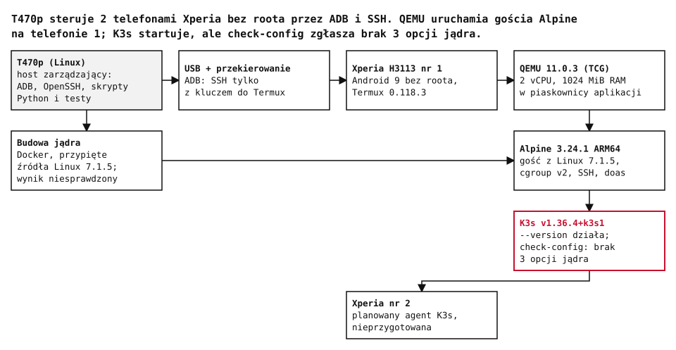

# agro-kubernetes

[English](README.md)

Hobbystyczne laboratorium Kubernetes. Projekt sprawdza, czy 2 telefony Sony Xperia H3113 mogą pracować jako węzły klastra. Android na obu telefonach zostaje bez roota i z zablokowanym bootloaderem. QEMU uruchamia na każdym telefonie osobne jądro Linux ARM64. Projekt bada limity zasobów, sieć gościa i powrót do pracy po utracie połączenia zarządzającego.



## Stan

Stan na 2026-09-25: pierwszy telefon Xperia ma działającego gościa Linux. Kubernetes blokują brakujące opcje jądra. Drugi telefon nie jest przygotowany.

| Składnik | Stan zaobserwowany |
|---|---|
| Telefon | H3113, Android 9 / 50.2.A.3.77; bootloader zablokowany, Android bez roota |
| Zarządzanie | Termux 0.118.3; osobny dostęp SSH tylko z kluczem przez USB i ADB |
| Emulator | QEMU 11.0.3, wielowątkowy TCG, 2 vCPU i 1024 MiB RAM |
| Gość | Oficjalny obraz Alpine 3.24.1 tiny ARM64 cloud; Linux 7.1.5 wyodrębniony z Podroid v1.2.9 bez instalacji APK |
| Dostęp do gościa | SSH tylko z kluczem jako `alpine`; administracja przez `doas` |
| Usługi gościa | Sprawdzone: czysty cgroup v2 i `mdevd` |
| Pamięć masowa | System plików root powiększony do 3,7 GiB; po rozpakowaniu zasobów K3s zostaje 3,1 GiB wolnego miejsca (wartość przybliżona) |
| Powrót do pracy | QEMU i SSH do gościa przetrwały rzeczywistą utratę i powrót połączenia ADB |
| Praca przy wygaszonym ekranie | 2 próbki w odstępie 341 s pokazały ten sam boot ID gościa, gdy Android raportował uśpienie |
| Kubernetes | K3s v1.36.4+k3s1 wykonuje `--version`; `check-config` kończy pracę kodem `4` i zgłasza brak 3 opcji jądra |
| Jądro zastępcze | Budowa Linux 7.1.5 ze źródeł trwa; wynik, uruchomienie i zgodność w działaniu są niesprawdzone |
| Przygotowanie obciążenia testowego | Oficjalne archiwum air-gap leży w gościu i ma sprawdzoną zawartość; manifest smoke przeszedł parsowanie offline i nie został zastosowany |

Żadna usługa K3s, żaden węzeł w stanie Ready, żaden Pod i żadne obciążenie testowe nie są sprawdzone. Gość ma 1024 MiB RAM. Dokumentacja K3s wymaga dla serwera co najmniej 2 GB RAM i 2 rdzeni CPU. Szczegóły podają [wymagania K3s](https://docs.k3s.io/installation/requirements) i [zapis weryfikacji](docs/verification.md): dokładna blokada jądra i granice testów.

## Architektura

T470p zarządza Termuxem przez połączenie SSH przekierowane przez ADB. QEMU działa w piaskownicy aplikacji Android i uruchamia gościa bezpośrednio ze sprawdzonego jądra. Obraz cloud jest plikiem bazowym dla zapisywalnej nakładki qcow2 w prywatnej pamięci aplikacji. Gość nie używa żadnej partycji telefonu jako dysku.

Cel: 1 serwer K3s i 1 agent K3s na 2 telefonach Xperia. T470p zostaje hostem zarządzającym. Nierozwiązane są 3 sprawy: zgodność jądra, zasoby serwera i sieć gości między telefonami. Obecną i planowaną topologię opisuje [architektura](docs/architecture.md) (po angielsku).

## Wymagania i punkty wejścia

Konfiguracja wymaga autoryzowanego debugowania USB, Termuxa i hosta Linux z ADB, OpenSSH, Bashem, Pythonem 3.11 lub nowszym, `curl` i `bsdtar`. Klucze, pobrane artefakty i stan maszyn wirtualnych zostają poza Gitem. Skrypty obsługują pierwszy telefon. Inny telefon wymaga osobno sprawdzonych tożsamości, ścieżek stanu i mapowania portów.

| Punkt wejścia | Działanie |
|---|---|
| [termux-inventory.sh](scripts/termux-inventory.sh), [termux-access.sh](scripts/termux-access.sh) | Sprawdzają Termux i konfigurują jego osobny nasłuch SSH na interfejsie loopback |
| [termux-install-qemu.sh](scripts/termux-install-qemu.sh) | Instaluje QEMU i sprawdza dostępne narzędzia i firmware |
| [prepare-cloud.py](scripts/prepare-cloud.py) | Sprawdza przypięty obraz cloud i tworzy ziarno NoCloud z kluczem publicznym |
| [prepare-kernel.py](scripts/prepare-kernel.py) | Sprawdza i wyodrębnia samodzielne jądro i wbudowaną konfigurację |
| [build-kernel.sh](scripts/build-kernel.sh) | Buduje zastępcze jądro ARM64 z przypiętych źródeł i wyodrębnionej konfiguracji bazowej |
| [termux-kernel-start.sh](scripts/termux-kernel-start.sh) | Uruchamia obecnego gościa cloud ze sprawdzonym jądrem |
| [xa2-ssh](scripts/xa2-ssh), [xa2-guest-ssh](scripts/xa2-guest-ssh) | Łączą z Termuxem i z gościem Alpine |
| [smoke.yaml](manifests/smoke.yaml) | Przygotowane obciążenie HTTP BusyBox bez roota i usługa NodePort; niewdrożone |

Instrukcja [runbook](docs/runbook.md) opisuje komendy przygotowania, budowę jądra w Dockerze, położenie artefaktów, ręczne zmiany w gościu i mapowanie portów. Tworzenie klastra nie jest zautomatyzowane ani sprawdzone od początku do końca.

## Weryfikacja i ograniczenia

Uruchom lokalne testy z katalogu głównego repozytorium:

```sh
python3 -B -m unittest discover -s tests -v
for script in scripts/*.sh; do
    bash -n "$script" || exit
done
sh -n scripts/guest-install.sh
sh -n scripts/xa2-ssh
sh -n scripts/xa2-guest-ssh
git diff --check
```

Testy przygotowania, konfiguracji jądra i skryptu startowego używają lokalnych danych testowych. Pomiary z telefonu zawiera osobny [zapis weryfikacji](docs/verification.md). Niesprawdzone zostają: restart Androida, utrata zasilania, dłuższa praca przy wygaszonym ekranie i sieć 2 węzłów.

[Panel recepcji](docs/reception-target.md) to wyłącznie specyfikacja przyszłego obciążenia. Aplikacje firmowe, istniejące dane, usługi i produkcyjne dane logowania zostają poza telefonami.

## Licencja

MIT. Patrz [LICENSE](LICENSE).
