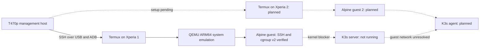

# Architecture

## Current system and target topology

The first Xperia H3113 runs a usable Alpine guest under QEMU inside Termux. Android remains locked
and unrooted. Guest SSH and cgroup v2 work; K3s is blocked by three missing kernel features.
The second Xperia has not been provisioned. Dashed connections represent planned components.

Both Kubernetes nodes must run on the Xperias. The T470p provides management and artifact
preparation. The wider hardware inventory comprises the T470p, OnePlus CE3 Lite, two H3113 phones,
OnePlus CE5 and LG G2; roles for the OnePlus and LG devices are unassigned.

## Guest kernel boundary

The inspected Android host exposes mixed cgroup v1/v2 mounts and confines Termux to an unprivileged
app sandbox. PRoot does not supply real root, kernel namespaces or cgroup isolation. See
[PRoot limitations](https://github.com/termux/proot-distro#limitations).

K3s rootless mode requires delegated pure cgroup v2 and does not currently support multi-node
rootless clusters. Those restrictions do not meet the observed Android host configuration and
the two-node objective. See [K3s rootless mode](https://docs.k3s.io/advanced#running-rootless-servers-experimental).

QEMU full-system emulation supplies a separate kernel and guest-root privileges without rooting
Android. The working guest has pure cgroup v2 with controllers including `cpu`, `cpuset`, `io`,
`memory` and `pids`. It uses `mdevd` instead of the incompatible helper-based `mdev` setup.
See [QEMU system emulation](https://www.qemu.org/docs/master/system/introduction.html).

## Boot artifacts and resources

[termux-kernel-start.sh](../scripts/termux-kernel-start.sh) defines the current boot profile:

| Setting | Value |
|---|---|
| QEMU | 11.0.3; machine `virt`, GICv3 |
| CPU and acceleration | `max,pauth-impdef=on`; multithreaded TCG, 256 MiB translation buffer |
| Guest resources | Two vCPUs, 1024 MiB RAM |
| Kernel | Linux 7.1.5 from the pinned Podroid v1.2.9 artifact; `CONFIG_HZ=100` |
| Boot method | Direct `-kernel`; root `/dev/vda2`, ext4, serial console `ttyAMA0` |
| Root image | Official Alpine 3.24.1 tiny aarch64 cloud image |
| Guest disk | Writable 4 GiB qcow2 overlay over the verified cloud base image |
| Initial configuration | NoCloud seed with hostname, `alpine` user and an Ed25519 public key |

The kernel preparer checks the APK and extracted Image hashes, ARM64 image format and selected
built-in kernel features. The APK is only an extraction source and has never been installed on
Android. These checks do not establish a reproducible build or a verified upstream attestation.
The initial feature gate also does not cover every requirement checked by K3s.

The overlay preserves the base image, which must remain at its referenced relative path.
The launcher expands the virtual disk to 4 GiB when creating it; guest partition and filesystem
expansion were separate manual operations. The measured root filesystem is now 3.7 GiB with
approximately 3.1 GiB available after K3s extracted its assets.

The current memory allocation remains below the K3s server baseline of 2 GB RAM. Its documented
CPU minimum is two cores, and baseline resources exclude application workloads. Two emulated
vCPUs do not establish adequate performance. See [K3s requirements](https://docs.k3s.io/installation/requirements).

## Kubernetes blocker

The verified K3s v1.36.4+k3s1 binary runs, but `check-config` exits `4` because these required options
are missing from the current kernel:

- `CONFIG_IP_NF_TARGET_REJECT`
- `CONFIG_NETFILTER_XT_MATCH_MULTIPORT`
- `CONFIG_NETFILTER_XT_MATCH_STATISTIC`

A compatible replacement kernel has not yet been verified. There is no running K3s service,
Ready node or validated Pod. Successful guest boot and cgroup setup do not establish Kubernetes
readiness.

The replacement build route uses [build-kernel.sh](../scripts/build-kernel.sh) and the
[cross-compilation image](../docker/kernel-builder.Dockerfile). It starts from checksum-pinned
Linux 7.1.5 source and the extracted baseline configuration, then applies eleven built-in network
options from [k3s-kernel.config](../config/k3s-kernel.config). The script resolves and validates
the resulting configuration before compiling the ARM64 Image in a container limited to three
CPUs and 4 GiB RAM with networking disabled. The source build is in progress; its final output
and guest behavior remain unverified. Build metadata records hashes and toolchain versions,
without establishing bitwise reproducibility or an upstream attestation.

The launcher accepts an optional directory containing `Image`, `kernel.config` and
`build-metadata.json`. Before creating an overlay or starting QEMU, it validates the expected
source and baseline hashes, release `7.1.5-agro1`, Image/configuration hashes, ARM64 format and
required built-in options including HZ 100. These are local artifact consistency checks. The
no-argument path retains the extracted baseline kernel; replacement-kernel boot remains pending.

## Networking and failure domains

Management SSH and the QEMU service forwards bind to phone loopback. Device-specific ADB forwards
provide management-host access. Guest networking uses QEMU user-mode NAT; the
[runbook](runbook.md) lists the ports. A forwarded Kubernetes API would not establish cross-node
routing or pod-network connectivity.

QEMU and guest SSH survived an actual ADB transport loss and subsequent recovery. This measures
management-transport independence during that event. Two screen-off samples taken 341 seconds
apart retained the same guest boot ID and unchanged Android wake/sleep timestamps. Android reboot,
power loss, longer-duration operation, thermal limits and cross-phone network recovery remain
separate tests.

The planned topology has one K3s server with SQLite and one agent. It has a single control-plane
failure domain; embedded-etcd high availability requires at least three servers. See
[K3s datastores](https://docs.k3s.io/datastore) and
[embedded-etcd HA](https://docs.k3s.io/datastore/ha-embedded).

## Workload boundary

The prepared [smoke manifest](../manifests/smoke.yaml) defines a non-root BusyBox HTTP Deployment
with a read-only root filesystem, a memory-backed content volume and NodePort 30080. Its image is
pinned by digest from the verified official air-gap archive. The YAML has been parsed offline;
the manifest has not been applied and no Pod or service response has been verified.

The current system is a guest and Kubernetes compatibility experiment. The reception panel is a
[future workload specification](reception-target.md). Business workloads, existing data and
production credentials remain off the phones.
