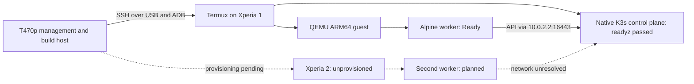

# Architecture

## Current system

The first Xperia runs an unmodified K3s v1.36.4+k3s1 control plane natively inside Termux.
All native `/readyz` checks passed, including RBAC. The Alpine guest has joined as worker `xa2-01`
and reached Ready with no taints or pressure. Containerd 2.3.4-k3s1 and a CSINode are present.
The smoke Pod is 1/1 Running with zero restarts and has returned exact HTTP responses. Later
NodePort timeouts leave stable availability unresolved. CoreDNS is Running but 0/1 Ready;
DNS, policy behavior and API-to-kubelet proxy reliability remain unverified.

The two-phone objective requires actual Kubernetes worker nodes on the Xperias. The T470p remains
a management/build host. The wider inventory also includes OnePlus CE3 Lite, OnePlus CE5 and LG G2;
roles for those devices are unassigned.

## Native control plane

K3s runs as Termux UID 10179 with rootless and agentless server settings. Installed PRoot
5.1.107.95 runs in passthrough mode using `-r /` and the private state directory as its working
directory. It provides Linux syscall compatibility without a separate distribution, fake UID,
fake kernel version or seccomp override. Android seccomp remains at mode `2`.

The observed compatibility failure involved Go executable lookup: Android blocked `faccessat2`.
PRoot returned `ENOSYS`, allowing Go's normal permission-check fallback. The combined upstream
rootless/disable-agent path did not create RootlessKit namespaces. This observed control-plane
path does not establish general rootless multi-node support. The first guest is registered;
workload networking and the two-phone topology remain unverified.

The dedicated runit service `agro-k3s-control` supervises the process and bounds its private logs.
Configuration, data and kubeconfig live under `$HOME/mobile-lab/native-control` in Termux.
The rootless node-password path is `data/agent/etc/rancher/node` beneath that directory.
Tokens, credentials and node addresses are private runtime inputs.

An explicit phone IPv4 node address is required because Android default-route discovery fails.
The API binds phone `127.0.0.1:16443`, advertises `10.0.2.2`, and includes `127.0.0.1` and
`10.0.2.2` in its TLS SANs. Its egress selector mode is `cluster`. The advertised address is the
QEMU SLIRP host gateway used by the local guest, not a cross-phone route.

## Linux worker boundary

PRoot does not provide the real namespaces and privileged kernel operations needed for the
worker. QEMU supplies a separate Linux kernel and guest-root privileges while Android remains
locked and unrooted. See [PRoot limitations](https://github.com/termux/proot-distro#limitations)
and [QEMU system emulation](https://www.qemu.org/docs/master/system/introduction.html).

| Guest setting | Current worker profile |
|---|---|
| Emulator | QEMU 11.0.3; machine `virt`, GICv3 |
| CPU and acceleration | `max,pauth-impdef=on`; two vCPUs; multithreaded TCG with a 128 MiB translation buffer |
| Guest memory | 768 MiB |
| Kernel | Built upstream Linux 7.1.5-agro1, HZ 100 and eleven additional network built-ins |
| Root image | Official Alpine 3.24.1 tiny aarch64 cloud image |
| Boot | Direct kernel; ext4 root `/dev/vda2`; serial console `ttyAMA0` |
| Disk | Existing 4 GiB qcow2 overlay; root filesystem manually expanded to 3.7 GiB |
| Guest facilities | Pure cgroup v2, `mdevd`, key-only SSH as `alpine` and `doas` |

The worker reuses the existing disk and built kernel. Its K3s kernel check passed with exit `0`;
the measured run took 442 seconds. Worker capacity under emulation remains unproven. The
[K3s requirements](https://docs.k3s.io/installation/requirements) distinguish server and worker
baselines and exclude application resource usage.

## Kernel build and artifact validation

[build-kernel.sh](../scripts/build-kernel.sh) compiles pinned Linux 7.1.5 source using the
[cross-compilation image](../docker/kernel-builder.Dockerfile), an extracted baseline configuration
and [eleven network additions](../config/k3s-kernel.config). Configuration is resolved and checked
before compilation in a container limited to three CPUs and 4 GiB RAM with networking disabled.

The completed `7.1.5-agro1` Image is 63,461,888 bytes with SHA-256
`257e234ec595d1d51ff3935d9e52500267d70c48f37b7bb47d180b6db338902d`.
Its embedded configuration matches the built configuration. The guest boot and K3s configuration
check passed. Metadata records artifact and input hashes and toolchain versions; bitwise
reproducibility and upstream attestation remain unverified.

The launcher validates `Image`, `kernel.config` and `build-metadata.json` together before side
effects. It checks source/baseline identity, the release, hashes, ARM64 format and required
built-ins. Its no-argument path retains the earlier extracted baseline kernel, which lacks three
K3s requirements. The current worker uses the built-kernel directory argument.

## Why the control plane moved out of the VM

Full K3s in the two-vCPU/1 GiB TCG guest repeatedly encountered authentication and controller
bootstrap timeouts. A guest-based agentless API became ready once, then its controller manager
timed out and restarted. No out-of-memory event was found.

A public-input scrypt probe using Go 1.26.7 and effective `golang.org/x/crypto` v0.47.0 recorded
0.858 seconds in native Termux and 14.501 seconds in the guest for two calls with
`N=32768`, `r=8`, `p=1` and a 64-byte result. Each environment has one sample and different available
CPU counts. This comparison supports investigation of emulation overhead; it is not a general
performance ratio or proof of the sole cause of every timeout.

## Networking, recovery and scope

The guest API host forward has been removed so the native control plane owns phone port 16443.
Guest SSH, serial-console and HTTP forwards are unchanged. Worker registration verifies the local
guest-to-control API route. Direct Pod HTTP and guest, phone and laptop forwarding paths each
returned the expected response at least once. Sustained availability and the future cross-phone
data network need separate tests.

Earlier QEMU/SSH checks survived an ADB transport interruption and retained the same guest boot
ID at two screen-off observations. The native control plane subsequently survived a USB outage
with the same service process for over 42 minutes and passed all readiness checks after recovery.
In a later controlled 30-second outage of the dedicated ADB server, Pod identity, container
identity, restart count and readiness were preserved on reconnection. Phone HTTP probes timed
out both during and after that test, so service continuity failed. Later phone/laptop NodePort
probes and an API-to-kubelet TLS handshake also timed out at ten seconds. Their cause is unresolved;
the evidence does not establish CPU or USB as the cause. Android reboot and power loss remain untested.

There is one control plane and no high-availability claim. The
[smoke manifest](../manifests/smoke.yaml) passed server validation and was applied, but its initial
180-second rollout timed out. The first Pod sandbox exceeded the default four-minute deadline.
An experimental [kubelet drop-in](../config/kubelet-tcg.conf) sets the runtime request timeout to
five minutes, yielding a ten-minute sandbox deadline in the pinned implementation. Smoke later
reached Running, but the setting's effect and sustained workload behavior are unverified. This
is not an upstream TCG recommendation. See
[CRI timeout handling](https://github.com/k3s-io/kubernetes/blob/5f3efbf9f6b592422439471c5fe1a1ab2887e189/staging/src/k8s.io/cri-client/pkg/remote_runtime.go#L220-L238).

The [air-gap preparer](../scripts/prepare-airgap.py) derives a smaller archive for BusyBox, pause
and CoreDNS from the pinned official archive. It retains the original image pins and ARM64 blobs;
unchanged root image indexes still contain upstream non-ARM descriptors. Runtime import and any
speed improvement from this subset remain unverified.

The [network-policy fixture](../manifests/network-policy-probe.yaml) has not been applied. All
business workloads remain outside the lab; the [reception panel](reception-target.md) is a future
specification only.
