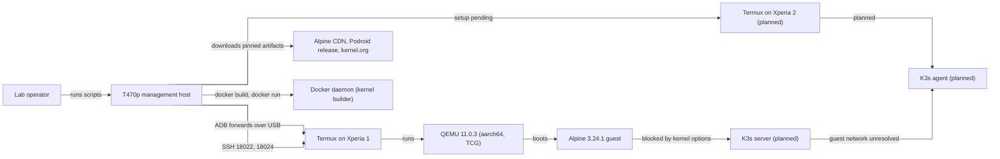
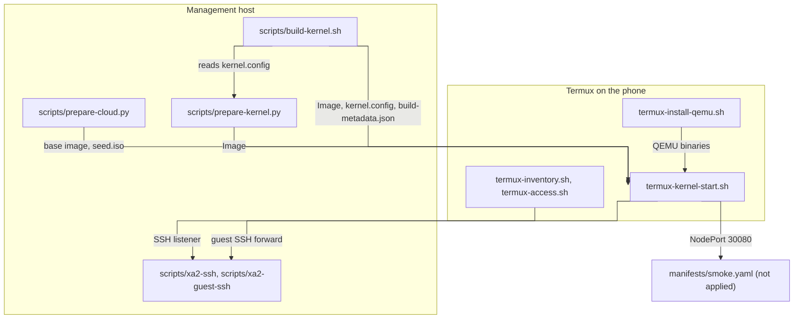
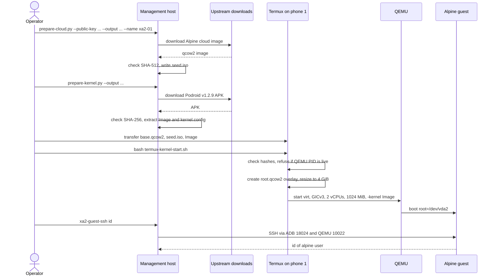

# agro-kubernetes architecture

This document describes the lab in the arc42 layout. It summarises and links the existing records: [architecture notes](../architecture.md), [runbook](../runbook.md), [verification record](../verification.md) and [reception target](../reception-target.md). State as of 2026-09-25, the date of the verification record.

## 1 Introduction and goals

agro-kubernetes is a hobby Kubernetes lab. It explores two Sony Xperia H3113 phones as real cluster nodes while Android stays locked and unrooted. QEMU runs an ARM64 Alpine Linux guest with its own kernel inside Termux on each phone.

Goals:

| Priority | Goal | State |
|---|---|---|
| 1 | Run a Linux guest with real root and pure cgroup v2 on an unrooted phone | Verified on phone 1 |
| 2 | Run one K3s server and one K3s agent on the two phones | Blocked: `k3s check-config` exits `4`, three kernel options missing |
| 3 | Study resource limits, guest networking and recovery after management disconnections | ADB transport loss recovery verified once; two-node networking untested |
| 4 | Keep business workloads, data and production credentials off the phones | Holds: the reception panel is a specification only |

Stakeholders: the lab owner (operator of the management host and the phones).

## 2 Constraints

- Hardware: Sony Xperia H3113, Android 9, locked bootloader; no rooting, no flashing, no phone partition used as a guest disk.
- Android runs Termux in an unprivileged app sandbox; PRoot gives no real root, namespaces or cgroup isolation (`docs/architecture.md`, "Guest kernel boundary").
- Guest resources: 2 vCPUs and 1024 MiB RAM under multithreaded TCG, below the K3s server baseline of 2 GB RAM.
- Management host: Linux with ADB, OpenSSH, Bash, Python 3.11 or newer, `curl` and `bsdtar`; Docker for the optional kernel build.
- Keys, downloaded artifacts and VM state stay outside Git (`.gitignore`, README).
- License: MIT (`LICENSE`).

## 3 Context and scope

| Neighbour | Interface |
|---|---|
| Phone 1 (Termux) | SSH on phone loopback `127.0.0.1:8022`, reached through ADB forward 18022; scripts staged under `/sdcard/Android/data/com.termux/files/mobile-lab`. |
| Alpine guest | SSH on guest TCP 22, reached through QEMU forward 10022 and ADB forward 18024. |
| Upstream artifacts | Alpine cloud image (SHA-512 pinned), Podroid v1.2.9 APK (SHA-256 pinned), Linux 7.1.5 source (SHA-256 pinned). |
| Docker | `docker/kernel-builder.Dockerfile` (Debian bookworm, pinned by digest) and `scripts/build-kernel.sh`. |
| CI | `.github/workflows/ci.yml` and `.gitlab-ci.yml`: unit tests and shell syntax checks. |

## 4 Solution strategy

- Full-system emulation gives the guest its own kernel and root without rooting Android ([ADR 0001](adr/0001-qemu-guest-on-unrooted-android.md)).
- Every downloaded input is pinned by hash and checked before use ([ADR 0002](adr/0002-pinned-hash-verified-artifacts.md)).
- The missing kernel options are added by a source build in an isolated container ([ADR 0003](adr/0003-isolated-kernel-build-container.md)).
- Every management and guest port binds to loopback and is reached only through ADB forwards with key-only SSH ([ADR 0004](adr/0004-loopback-ports-adb-forwards.md)).
- The target cluster is one K3s server with SQLite and one agent ([ADR 0005](adr/0005-single-server-k3s-target.md)).

## 5 Building block view

| Block | Responsibility |
|---|---|
| `scripts/prepare-cloud.py` | Downloads or reuses the pinned Alpine cloud image, checks its SHA-512, validates the public key and writes a NoCloud `seed.iso`. |
| `scripts/prepare-kernel.py` | Downloads the pinned Podroid APK as an archive, checks its SHA-256, extracts only `Image` and `kernel.config`, writes `verification.json`. |
| `scripts/build-kernel.sh` | Builds Linux 7.1.5 for ARM64 from pinned source, the extracted baseline and `config/k3s-kernel.config`. |
| `scripts/termux-inventory.sh`, `scripts/termux-access.sh` | Inspect Termux; configure a key-only SSH listener on `127.0.0.1:8022`. |
| `scripts/termux-install-qemu.sh` | Installs QEMU packages in Termux. |
| `scripts/termux-kernel-start.sh` | Current launcher: checks hashes, creates the qcow2 overlay, boots the guest by direct kernel boot; accepts an optional built-kernel directory. |
| `scripts/termux-cloud-start.sh`, `scripts/termux-vm-start.sh`, `scripts/guest-install.sh` | Alternative UEFI boot and the earlier ISO installation experiment; not the current path. |
| `scripts/xa2-ssh`, `scripts/xa2-guest-ssh` | SSH wrappers with a dedicated key and strict host-key checking. |
| `manifests/smoke.yaml` | Non-root BusyBox HTTP workload with NodePort 30080; parsed offline, not applied. |
| `tests/` | 28 unit tests for the preparers, the kernel build script and the launcher. |

## 6 Runtime view

Main scenario: prepare artifacts and boot the guest on phone 1 (runbook, "Prepare the cloud image and kernel" and "Stage and boot the guest").

## 7 Deployment view

| Node | Software | Ports (loopback) |
|---|---|---|
| T470p management host | ADB, OpenSSH, Python 3.11+, Docker (optional) | 18022, 18023, 18024, 16443, 18080 (ADB forwards) |
| Xperia 1, Termux | OpenSSH, QEMU 11.0.3, `qemu-img` | 8022 (Termux SSH), 10023 (guest console), 10022, 16443, 10080 (QEMU forwards) |
| Alpine guest on Xperia 1 | Alpine 3.24.1, `mdevd`, cgroup v2, K3s v1.36.4+k3s1 binary | 22 (SSH), 6443 and 30080 reserved for K3s |
| Xperia 2 | Not provisioned | None |

Port mapping, from the runbook "Port mappings and recovery" table:

| Host | Phone | Guest | Purpose |
|---|---|---|---|
| 18022 | 8022 | None | Termux management SSH |
| 18023 | 10023 | QEMU serial device | Guest console |
| 18024 | 10022 | TCP 22 | Guest SSH |
| 16443 | 16443 | TCP 6443 | Future Kubernetes API |
| 18080 | 10080 | TCP 30080 | Future test service |

CI runs on GitHub Actions (push to `main`, pull requests) and GitLab CI (`python:3.11-slim-bookworm`): unit tests and `bash -n` or `sh -n` on every script.

## 8 Crosscutting concepts

- Verification before side effects: preparers and the launcher check hashes and formats before they create an overlay or start QEMU.
- Shell safety: every shell script starts with `set -eu` (`build-kernel.sh`: `set -euo pipefail`); every shell script except the two SSH wrappers and `termux-inventory.sh` also sets `umask 077`.
- Secrets: a dedicated Ed25519 key and separate known-hosts files live under `${XDG_STATE_HOME:-$HOME/.local/state}/mobile-lab/xa2-01`, outside Git; only the public key reaches the phone and the seed.
- State layout: phone state lives in Termux app-private storage under `$HOME/mobile-lab/`; the overlay `root.qcow2` keeps a relative backing path `../xa2-01-cloud/base.qcow2`.
- Evidence discipline: the verification record separates verified, observed, untested and pending results.

## 9 Architecture decisions

- [ADR 0001: QEMU full-system guest on unrooted Android](adr/0001-qemu-guest-on-unrooted-android.md)
- [ADR 0002: Pinned, hash-verified artifacts](adr/0002-pinned-hash-verified-artifacts.md)
- [ADR 0003: Kernel build in an isolated container](adr/0003-isolated-kernel-build-container.md)
- [ADR 0004: Loopback-only ports behind ADB forwards](adr/0004-loopback-ports-adb-forwards.md)
- [ADR 0005: One K3s server with SQLite and one agent](adr/0005-single-server-k3s-target.md)

## 10 Quality requirements

| Quality | Scenario | Measure |
|---|---|---|
| Integrity | A downloaded artifact differs from the pinned one | The preparer or launcher stops before any side effect |
| Recoverability | The ADB transport drops and returns | QEMU and guest SSH keep running (verified once) |
| Continuity | The phone screen turns off | Same guest boot ID across samples 341 seconds apart (observed) |
| Security | A client tries password login to Termux SSH | Refused: `PasswordAuthentication no`, `KbdInteractiveAuthentication no` |
| Maintainability | A script change breaks syntax or a preparer | CI fails on `unittest` or `bash -n` / `sh -n` |

## 11 Risks and technical debt

- K3s is blocked: the running kernel lacks `CONFIG_IP_NF_TARGET_REJECT`, `CONFIG_NETFILTER_XT_MATCH_MULTIPORT` and `CONFIG_NETFILTER_XT_MATCH_STATISTIC`; the replacement build has not been verified.
- 1024 MiB guest RAM is below the K3s server baseline of 2 GB.
- Several guest changes are manual (`mdevd`, cgroups service, partition growth, K3s binary placement) and are not reproduced by the scripts.
- All launchers share the same phone ports; their PID checks do not coordinate, so only one guest may run.
- One server with SQLite is a single control-plane failure domain.
- Android reboot, power loss, longer screen-off periods, thermal limits and two-node networking are untested.
- The scripts target phone 1 only; a second phone needs its own identities, state paths and ports.

### Open questions

- Whether the replacement kernel `7.1.5-agro1` boots and passes `k3s check-config`: the verification record lists the build as in progress.

## 12 Glossary

| Term | Definition |
|---|---|
| ADB | Android Debug Bridge; carries the TCP forwards between the management host and the phone. |
| Termux | Android terminal app that hosts OpenSSH and QEMU in its app sandbox. |
| TCG | QEMU Tiny Code Generator; software CPU emulation. |
| NoCloud seed | `seed.iso` with the `CIDATA` label that cloud-init reads for hostname, user and key. |
| Overlay | A qcow2 image that stores guest writes over a read-only base image. |
| K3s | Lightweight Kubernetes distribution targeted by the lab. |
| Air-gap archive | Official K3s image archive staged in the guest for offline use. |
| `xa2-01` | Lab identifier of phone 1 used in state paths and wrapper names. |
